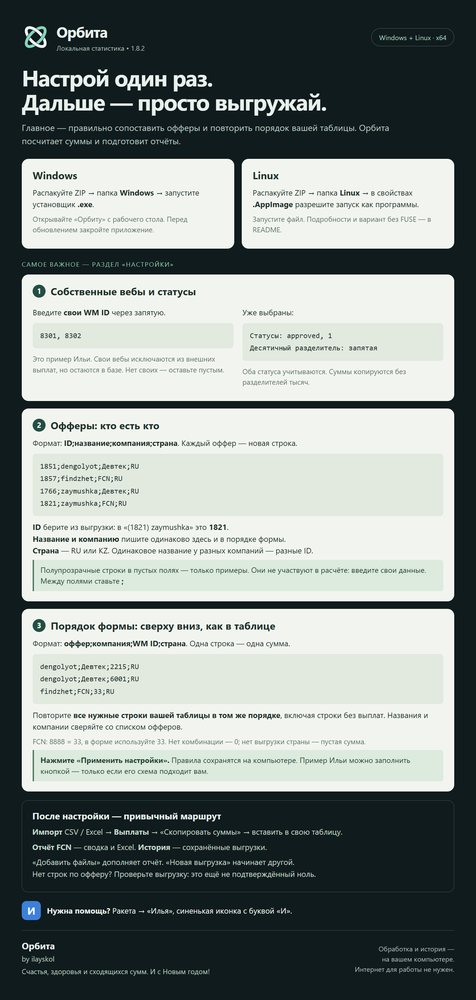

# Орбита

Локальная статистика без ежемесячных мучений. **by ilayskol**

## Скачать

### 🪟 [Windows — скачать установщик EXE](https://github.com/ilayskol/Orbita/releases/download/v1.8.2/Orbita-Setup-1.8.2.exe)
### 🐧 [Linux — скачать AppImage](https://github.com/ilayskol/Orbita/releases/download/v1.8.2/Orbita-1.8.2-linux-x86_64.AppImage)

[Общий ZIP для обеих систем — 227 МБ](https://github.com/ilayskol/Orbita/releases/download/v1.8.2/Orbita-1.8.2-Windows-Linux.zip)

**Версия 1.8.2.** Windows: скачайте EXE и запустите — распаковывать его не нужно. Linux: разрешите AppImage запускаться как программе и откройте файл. Если выбрали общий ZIP, сначала распакуйте его.

> **Code → Download ZIP** скачивает материалы этой страницы. Для установки используйте ссылки выше.

Выплаты, суммы для вставки в таблицу и отчёты FCN из CSV / Excel. Обработка и история — локально на компьютере.

## Как настроить и пользоваться

Ниже — полная памятка. Нажмите на картинку, чтобы открыть её в полном размере.

<strong>Открыть текстовую инструкцию и сведения о проверке</strong>

## Главное — правильно настроить

1. **Собственные вебы:** введите свои WM ID через запятую. Они остаются в базе, но исключаются из внешних выплат. Статусы `approved, 1` и десятичная запятая уже выбраны.
2. **Офферы:** одна строка — `ID;название;компания;страна`. ID берите из выгрузки; страна — RU или KZ. Одинаковое название у разных компаний может иметь разные ID.
3. **Порядок формы:** одна строка — `оффер;компания;WM ID;страна`. Повторите строки своей таблицы точно сверху вниз. Названия и компании должны совпадать со списком офферов. FCN: 8888 = 33.
4. Нажмите **«Применить настройки»**. Полупрозрачные примеры сами в расчётах не участвуют. Кнопка «Заполнить примером Ильи» нужна только тем, кому подходит эта схема.

Далее: **Импорт → Выплаты → Скопировать суммы**. Для FCN есть отдельная сводка и Excel. «Добавить файлы» дополняет отчёт, «Новая выгрузка» начинает другой. Ранее сохранённые выгрузки доступны в «Истории».

## Проверка версии 1.8.2

Windows: проверены первый запуск, настройка, сохранение после перезапуска, восстановление истории, импорт двух исходных CSV, расчёт и Excel. Linux: AppImage собрана, тесты локальной истории и настроек и запуск с песочницей в Linux-контейнере прошли; полный рабочий сценарий на обычном Linux-десктопе ещё не проверен.

Публичный репозиторий содержит описание и готовые файлы релизов. Клиентские выгрузки и личная история в релиз не включены.

Поддержка для коллег: в Ракете — «Илья», синенькая иконка с буквой «И».

