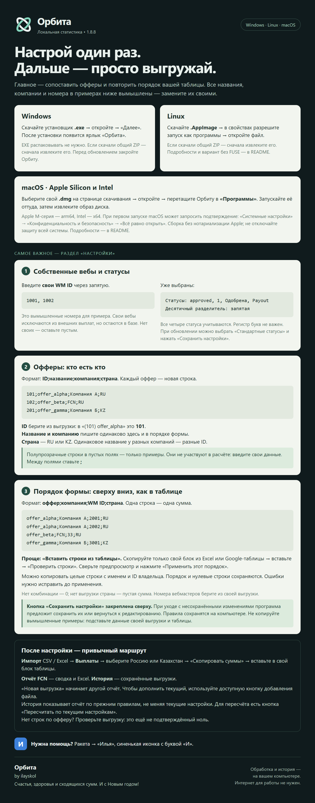

# Орбита

Локальная статистика без ежемесячных мучений. **by ilayskol**

Выплаты, суммы для вставки в выплатную форму, отчёты FCN и Excel из выгрузок лидов. Обработка и история — на вашем компьютере.

## Скачать

### 🪟 [Windows — установщик EXE](https://github.com/ilayskol/Orbita/releases/download/v1.8.8/Orbita-Setup-1.8.8.exe)
### 🐧 [Linux — AppImage](https://github.com/ilayskol/Orbita/releases/download/v1.8.8/Orbita-1.8.8-linux-x86_64.AppImage)

[Общий ZIP для Windows и Linux](https://github.com/ilayskol/Orbita/releases/download/v1.8.8/Orbita-1.8.8-Windows-Linux.zip)

**Версия 1.8.8.** Windows: откройте скачанный EXE и следуйте мастеру установки. Сам EXE распаковывать не нужно. Linux: разрешите AppImage запускаться как программе и откройте файл. Если скачали общий ZIP — сначала извлеките его. Перед обновлением закройте Орбиту.

> **Code → Download ZIP** скачивает материалы этой страницы. Для установки используйте ссылки выше.

## Настройка

1. **Собственные вебы:** введите свои WM ID через запятую. Их выплаты остаются в базе, но исключаются из внешних выплат. Статусы `approved, 1, Одобрена, Payout` и десятичная запятая уже выбраны.
2. **Офферы:** добавьте `ID;название;компания;страна`. ID берите из колонки «Оффер» в выгрузке. Страна — RU или KZ. Для отчёта FCN компания должна называться `FCN`. У оффера в разных компаниях могут быть разные ID.
3. **Порядок формы:** нажмите **«Вставить строки из таблицы»**. Скопируйте только свой блок из Excel или Google-таблицы, вставьте его и нажмите **«Проверить строки»**. Сверьте число строк, страны и последовательность в предпросмотре, затем нажмите **«Применить этот порядок»**. Непонятные строки, чужие владельцы и дубли требуют исправления.
4. **Сохранение:** кнопка «Сохранить настройки» закреплена сверху. При уходе с изменениями выберите «Сохранить и перейти», продолжение редактирования или явную отмену. Для старого набора из двух статусов нажмите «Стандартные статусы» и сохраните. Регистр букв не важен.

**Ручной ввод** тоже доступен: `оффер;компания;WM ID;страна`, сверху вниз как в вашей форме, включая нулевые строки. После ручных изменений нажмите **«Сохранить настройки»**.

Полупрозрачный текст и кнопка **«Заполнить примером»** содержат вымышленные названия и номера. Они показывают формат — замените их своей схемой. ID офферов автоматически из названий не создаются.

## Каждый месяц

**Импорт → Выплаты → выберите страну → Скопировать суммы → вставьте в свой столбец.** Россия и Казахстан копируются отдельно. До вставки сверяйте порядок и число строк.

**Отчёт FCN:** сводка для чата и отдельный Excel с лидами. Названия офферов и выбранный месяц попадают в короткий отчёт. Отсутствие строк в выгрузке не подтверждает отсутствие лидов в системе.

**Новая выгрузка** начинает другой отчёт. Доступная кнопка добавления файла дополняет текущий; совместимые повторы исключаются.

**История** показывает отчёт по сохранённым тогда правилам, не перезаписывая текущие настройки. Для пересчёта открытой выгрузки есть кнопка «Пересчитать по текущим настройкам». Исходная запись истории остаётся прежней.

Месяц в «Базе лидов» фильтрует базу отдельно. Выплаты и FCN ограничиваются выбранным месяцем только при включённом фильтре в настройках. Для пограничных дат проверьте часовой пояс выгрузки.

## Данные и совместимость

Интернет для работы не нужен. Клиентские выгрузки и личная история в установщик не включены. Локальная история не зашифрована: не передавайте её вместе с программой и не публикуйте свои отчёты.

Windows и Linux x64. На Windows проверен рабочий сценарий. На Linux проверены сборка и запуск в тестовой среде; полный сценарий на обычном Linux-десктопе отдельно не проверялся.

Поддержка для коллег: Ракета → «Илья», синяя иконка с буквой «И».
